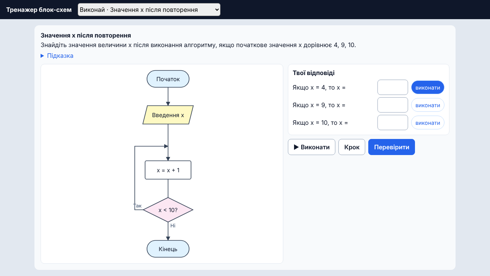

<h1 align="center">edu-flowchart</h1>

<p align="center">
  <b>An embeddable flowchart trainer: students build an algorithm, step through it and get it checked automatically.</b><br>
  Textbook blocks, school-style expressions, step-by-step execution and test-based grading that also runs on the server.
</p>

<p align="center">
  <a href="https://github.com/zavada123/edu-flowchart/actions/workflows/pages.yml"></a>
  <a href="https://zavada123.github.io/edu-flowchart/"></a>
  <a href="LICENSE"></a>
  
  
</p>

<p align="center">
  <a href="https://zavada123.github.io/edu-flowchart/"><b>Live demo</b></a> ·
  <a href="https://github.com/zavada123/edu-flowchart/actions/workflows/pages.yml"><b>CI &amp; deploys</b></a> ·
  <a href="#installation">Installation</a> ·
  <a href="#usage">Usage</a> ·
  <a href="#api">API</a>
</p>

<p align="center">
  <a href="https://zavada123.github.io/edu-flowchart/"></a>
</p>

## Why

Desktop tools like Flowgorithm and FlowRun are great for drawing flowcharts, but they do not work well on a phone and cannot report a grade back to a learning platform. `edu-flowchart` is open, touch-friendly and embeddable. A student builds the flowchart of an algorithm, runs it step by step while watching the variables, and the trainer checks it against test data and hands the result to your app.

The student-facing interface is in Ukrainian. It was built for [EduProstir](https://eduprostir.com), a Ukrainian learning platform.

## Features

- **Textbook blocks:** Start and End, Process, Input, Output, Decision, pre-test loop, post-test loop and "Repeat N times".
- **Always-valid structure:** the student taps "+" on an arrow and picks a block, so the chart is always well-formed (no spaghetti) and easy to edit with a finger. "Yes" goes left and "No" goes right, as in the textbooks.
- **Step-by-step or automatic execution:** the next block is highlighted, and variables and output are visible.
- **School-style expressions:** `S = a + b`, `S := a + b`, `Sr = S : 3`, `x // 10`, `a mod 2`, `a ≥ 5`, `a = 0?` (equality in a condition), `x > 0 і y > 0`, `не (a > b)`, `sqrt(x)`, `"Відповідь:", x`. Evaluated by a parser, never with `eval`.
- **Helpful errors next to the block:** "Variable «a» has no value yet", "Division by zero", "This loop probably never ends" (in Ukrainian).
- **Everyday algorithms for grades 3–5:** a plain-language action ("Walk to the apple tree") computes nothing, and a plain-language condition ("Are there apples?") is answered by the student with Yes / No buttons while running.
- **Two task types:**
  - **Build** (`build`): the student builds the chart and tests check its output. A task can require a decision or a loop and limit the block palette.
  - **Trace** (`trace`): the chart is given, the student predicts a variable's value, then runs the chart to check.
- **Large mode** for younger students.
- **Server-side re-check:** the same pure-TypeScript core grades the submitted program on your server.

## Installation

The package ships as TypeScript source and is compiled by your app's bundler (Vite, webpack, etc.). Install it straight from GitHub and pin a commit:

```bash
npm install github:zavada123/edu-flowchart#<commit>
```

Peer dependencies: `react` and `react-dom` 19 or newer.

## Usage

### React component

```tsx
import { FlowchartTrainer, tasks } from "edu-flowchart"

<FlowchartTrainer
  task={tasks[0]}
  initialProgram={draft}
  onChange={(program) => saveDraft(program)}
  onComplete={(report) => saveGrade(report)}
/>
```

`onComplete` is called after every press of «Перевірити» (Check). The `report`:

```json
{
  "taskId": "inf5-average",
  "mode": "build",
  "passed": true,
  "score": 1,
  "tests": [{ "inputs": { "a": 12, "b": 7, "c": 14 }, "passed": true, "expected": [11], "actual": [11] }],
  "issues": [],
  "program": { "blocks": [{ "id": "…", "kind": "input", "text": "a, b, c" }, "…"] }
}
```

### Grade on the server

Do not trust `passed` from the browser: re-run the check on your server with the submitted program.

```ts
import { checkBuild, checkTrace, tasks } from "edu-flowchart/core"

const task = tasks.find((t) => t.id === report.taskId)
if (!task) throw new Error("Unknown task")

const trusted = task.mode === "build"
  ? checkBuild(task, report.program ?? { blocks: [] })
  : checkTrace(task, report.answers ?? [])
```

### iframe

No React? Embed the hosted demo and listen for the result:

```html
<iframe src="https://zavada123.github.io/edu-flowchart/?embed=1&task=inf5-average"></iframe>
<script>
  window.addEventListener("message", (e) => {
    if (e.data?.type === "edu-flowchart:result") saveGrade(e.data.report)
  })
</script>
```

| Query parameter | Description |
|---|---|
| `embed=1` | Hide the demo header and task picker |
| `task=<id>` | Open this task |
| `large=1` | Large mode |

### Write a task

A **Build** task (see `src/core/tasks.ts`):

```ts
import type { Task } from "edu-flowchart/core"

const book: Task = {
  id: "inf5-book",
  mode: "build",
  title: "Книжка і сувенір",
  text: "Якщо ціна книжки не перевищує n гривень, купити цю книжку й сувенір…",
  hint: "«Не перевищує» означає «менша або дорівнює»: p <= n.",
  blocks: ["input", "process", "output", "if"],   // palette; all blocks when omitted
  require: ["if"],                                // structures the chart must contain: "if" or "loop"
  tests: [
    { inputs: { p: 100, n: 150 }, output: ["книжка і сувенір"] },
    { inputs: { p: 200, n: 150 }, output: ["книжка"] }
  ]
}
```

A test checks either the printed output (`output`, all values in order) or the final variable values (`vars`). Numbers are compared to six decimal places; text ignores case, extra spaces and trailing punctuation. If an input variable is read inside a loop, give its values as an array: `{ x: [3, 5, -1] }`. Answers to plain-language conditions work the same way: `{ "Є яблука": [true, true, false] }`.

A **Trace** task:

```ts
const traceLoop: Task = {
  id: "inf5-trace-loop",
  mode: "trace",
  title: "Значення x після повторення",
  text: "Знайдіть значення величини x після виконання алгоритму…",
  program: { blocks: [ /* the flowchart */ ] },
  questions: [{ inputs: { x: 4 }, ask: "x" }, { inputs: { x: 10 }, ask: "x" }]
}
```

Correct answers are never stored in a task: the trainer computes them by running the chart. Reference solutions for Build tasks live in the tests (`src/core/check.test.ts`), not in code shipped to students, and the tests check that every reference solution passes its task.

The demo tasks come from Ukrainian textbooks: Bondarenko, grade 5 (§ 19); Korniienko, grade 4; Ryvkind, grade 8 (loops).

## API

| Entry point | Contents |
|---|---|
| `edu-flowchart` | `FlowchartTrainer`, `Chart`, and everything from the core |
| `edu-flowchart/core` | Built-in `tasks`, `checkBuild`, `checkTrace`, the expression parser, the interpreter (`compile`, `start`, `step`, `runAll`), chart editing and layout. No React, safe for Node |

### `<FlowchartTrainer>` props

| Prop | Type | Description |
|---|---|---|
| `task` | `Task` | The task to show |
| `onComplete` | `(report: Report) => void` | Called after every press of the Check button |
| `onChange` | `(program: Program) => void` | Called after every edit, to keep a draft |
| `initialProgram` | `Program` | A saved draft to continue (Build tasks) |
| `large` | `boolean` | Bigger text and buttons for younger students. Default `false` |

### `Report`

| Field | Description |
|---|---|
| `taskId`, `mode` | The task and its type |
| `passed`, `score` | Whether everything passed, and the share of passed tests or right answers (0…1) |
| `tests` | Per test: inputs, expected and actual values, and an error if one stopped the run |
| `issues` | Problems that stop the chart from running, or a missing required structure |
| `program` / `answers` | The student's chart (Build) or answers (Trace), to store with the grade |

## Development

```bash
npm install
npm run dev        # demo at http://localhost:5173
npm test           # core tests (Vitest)
npm run build      # type check and build the demo into dist/
```

Every push to `main` runs the tests and deploys the demo to GitHub Pages: see the [workflow runs](https://github.com/zavada123/edu-flowchart/actions/workflows/pages.yml).

## License

[MIT](LICENSE)
